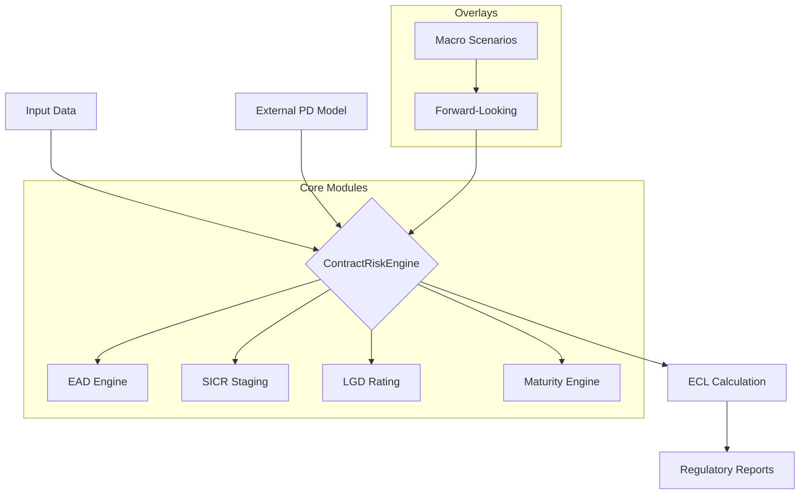

# Contract Risk Engine (SaaS-Ready)

[](https://www.python.org/downloads/)
[](https://opensource.org/licenses/MIT)
[](https://github.com/psf/black)
[](https://github.com/LuisPontes1/credit-risk-transition-matrix)

**Advances in Credit Risk Modeling for IFRS 9 / CPC 4.966 Compliance**

The **Contract Risk Engine** is a high-performance, modular Python library designed for financial institutions to calculate **Expected Credit Loss (ECL)** at the contract level. It orchestrates the full lifecycle of credit risk modeling — from empirical transition matrices to forward-looking macro overlays and SICR staging.

---

## 🚀 Key Features

- **End-to-End ECL Pipeline**: Orchestrates PD, LGD, EAD, SICR, and Maturity models into a single cohesive calculation.
- **IFRS 9 / CPC 4.966 Compliant**:
  - **Staging**: Automated classification (Stage 1/2/3) based on PD deterioration (relative/absolute) and backstops.
  - **Forward-Looking**: Semantic macro-economic scenarios (Optimistic, Base, Pessimistic) with probability weighting.
  - **Lifetime ECL**: Multi-period discounting with effective interest rates.
- **Advanced Modelling Modules**:
  - **Transition Matrix Learner**: Estimates migration probabilities from historical data.
  - **EAD Engine**: Empirical CCF estimation for revolving products.
  - **Maturity Engine**: Behavior-based tenure calculation (halflife) for checking accounts/credit cards.
  - **LGD Rating**: Downturn calibration and cure rate analysis.
- **Backtesting Suite**: Native support for PD calibration (Binomial test), Discrimination (AUC/Gini), and LGD validation.

---

## 🏗️ Architecture

The engine uses a modular architecture where the `ContractRiskEngine` acts as the orchestrator, integrating specialized components.



---

## 📦 Installation

```bash
git clone https://github.com/LuisPontes1/credit-risk-transition-matrix.git
cd credit-risk-transition-matrix
pip install -e .
```

Dependências opcionais:

```bash
pip install -e ".[interactive]"  # Plotly + Jupyter
pip install mlflow               # Integração MLflow (Databricks)
```

## Quick Start

```python
from credit_risk_transition_matrix import TransitionMatrixLearner

learner = TransitionMatrixLearner(
    buckets=[0, 15, 30, 60, 90, 120, 180, 240, 360],
    time_horizon=12
)

learner.fit(
    df,
    id_col="id_contrato",
    time_col="data_ref",
    bucket_col="dias_atraso"
)

# Matriz de transição
print(learner.transition_matrix_)

# Heatmap (matplotlib)
learner.plot_heatmaps(modes=["global"], save_dir="./outputs/")

# PD por bucket
pd_results = learner.calculate_pd(time_horizon=12)
```

## Funcionalidades

### Matriz de Transição

| Feature | Descrição |
|---------|-----------|
| Buckets customizáveis | Qualquer definição de faixas de atraso (dias) |
| Análise segmentada | Matrizes por segmento de carteira via `segment_col` |
| Ponderação por EAD | Matrizes ponderadas por exposição via `weight_col` |
| Spark DataFrame | Aceita PySpark DataFrames (conversão automática) |

```python
# Análise segmentada + ponderada por EAD
learner.fit(
    df,
    id_col="id_contrato",
    time_col="data_ref",
    bucket_col="dias_atraso",
    segment_col="produto",
    weight_col="valor_exposicao"
)

matrices = learner.transform(modes=["global", "segmented"])
```

### PD Engine

Funções standalone e métodos de conveniência no `TransitionMatrixLearner`:

```python
from credit_risk_transition_matrix import (
    cumulative_pd,
    marginal_pd,
    pd_term_structure,
    survival_curve,
    cure_rates,
    absorbing_analysis
)

# PD cumulativa para 12 períodos
cpd = cumulative_pd(learner.transition_matrix_, n_periods=12)

# PD marginal (condicional por período)
mpd = marginal_pd(learner.transition_matrix_, n_periods=12)

# Curva de sobrevivência
surv = survival_curve(learner.transition_matrix_, n_periods=12)

# Term structure completa (cumulative + marginal + survival)
ts = learner.get_pd_term_structure(n_periods=12)

# Cure rates (migração para faixas melhores)
cures = learner.get_cure_rates()

# Absorbing analysis (tempo esperado até default)
analysis = learner.get_absorbing_analysis()
print(analysis['expected_steps'])
print(analysis['absorption_probabilities'])
```

### Predição de Estados Futuros

```python
# Distribuição futura a partir de um bucket
future = learner.predict_transitions("30-59", n_periods=6)

# PD por bucket com horizonte customizado
pd_results = learner.calculate_pd(
    time_horizon=12,
    default_buckets=["240-359", "360+"]
)
```

### Validação do Modelo

```python
results = learner.validate_model(
    test_data=df_test,
    metrics=["accuracy", "stability", "coverage"]
)
# accuracy: % de transições com bucket mais provável correto
# stability: dominância diagonal da matriz
# coverage: % de células não-zero
```

### Visualizações

**Matplotlib** (padrão):
```python
learner.plot_heatmaps(modes=["global", "segmented"], save_dir="./outputs/")
```

**Plotly** (interativo, ideal para Databricks/Jupyter):
```python
from credit_risk_transition_matrix.visualization.plotly_charts import (
    plot_heatmap_plotly,
    plot_pd_curve_plotly
)

fig = plot_heatmap_plotly(learner.transition_matrix_, title="Matriz Global")
fig.show()

cpd = cumulative_pd(learner.transition_matrix_, n_periods=12)
fig = plot_pd_curve_plotly(cpd, title="PD Term Structure")
fig.show()
```

### Serialização

```python
# Salvar modelo
learner.save("model/transition_model.pkl")

# Carregar modelo
loaded = TransitionMatrixLearner.load("model/transition_model.pkl")
loaded.predict_transitions("0-14", n_periods=3)
```

### MLflow (Databricks)

```python
learner.log_to_mlflow(
    experiment_name="credit_risk_v2",
    run_name="monthly_calibration",
    extra_params={"portfolio": "PF"},
    extra_metrics={"accuracy": 0.85}
)
# Loga: params, metrics, transition_matrix.csv como artifact
```

---

## CPC 4966 / IFRS 9

### Stress Testing

Aplique choques na matriz de transição para cenários macroeconômicos:

```python
from credit_risk_transition_matrix import (
    apply_scalar_stress,
    generate_scenarios,
    weighted_scenario_matrix
)

# Stress escalar: piora migração por fator 1.5x
stressed = apply_scalar_stress(learner.transition_matrix_, stress_factor=1.5)

# Gerar cenários (base, otimista, pessimista)
scenarios = generate_scenarios(learner.transition_matrix_, {
    'base':        {'factor': 1.0, 'weight': 0.40},
    'otimista':    {'factor': 0.7, 'weight': 0.30},
    'pessimista':  {'factor': 1.8, 'weight': 0.30}
})

# Matriz ponderada por cenário (forward-looking)
fl_matrix = weighted_scenario_matrix(scenarios)
```

### Staging (IFRS 9)

Classifique contratos em Stage 1, 2 e 3:

```python
from credit_risk_transition_matrix import classify_stage, stage_summary

df_staged = classify_stage(
    df,
    bucket_col='bucket',
    bucket_labels=learner.bucket_labels_,
    stage1_max_bucket='15-29',
    default_buckets=['360+']
)
# → coluna 'stage' adicionada (1, 2 ou 3)

resumo = stage_summary(df_staged, stage_col='stage', ead_col='ead')
```

### ECL (Expected Credit Loss)

```python
from credit_risk_transition_matrix import ecl_by_stage, portfolio_ecl

# ECL por contrato (PD 12m p/ S1, lifetime p/ S2, 100% p/ S3)
df_ecl = ecl_by_stage(
    transition_matrix=learner.transition_matrix_,
    df=df_staged,
    bucket_col='bucket',
    stage_col='stage',
    ead_col='ead',
    lgd=0.45
)

# Resumo do portfólio por stage
resumo_ecl = portfolio_ecl(df_ecl)
```

---

## Dados de Entrada

| Coluna | Tipo | Obrigatório | Descrição |
|--------|------|:-----------:|-----------|
| `id_contrato` | str | ✅ | Identificador único do contrato |
| `data_ref` | datetime | ✅ | Data de referência da observação |
| `dias_atraso` | int | ✅ | Dias de atraso (usado para bucket assignment) |
| `segmento` | str | ❌ | Segmento da carteira |
| `valor_exposicao` | float | ❌ | Exposição (EAD) para ponderação |

## Notebook Demo

Veja o notebook completo com dados fictícios:

📓 [`notebooks/demo.ipynb`](notebooks/demo.ipynb) — demonstra todas as funcionalidades com uma carteira simulada de 500 contratos.

## Testes

```bash
pip install -e ".[dev]"
python -m pytest tests/ -v
```

## Estrutura do Projeto

```
credit-risk-transition-matrix/
├── src/credit_risk_transition_matrix/
│   ├── core/
│   │   ├── transition_matrix_learner.py  # Classe principal
│   │   ├── pd_engine.py                  # Motor de PD
│   │   ├── stress_testing.py             # Stress testing & cenários
│   │   ├── staging.py                    # Staging IFRS 9
│   │   ├── ecl_calculator.py             # ECL Calculator
│   │   ├── data_processor.py             # Processamento vetorizado
│   │   └── validators.py                 # Validação de inputs
│   ├── visualization/
│   │   ├── heatmaps.py                   # Matplotlib heatmaps
│   │   └── plotly_charts.py              # Plotly interativo
│   └── utils/
│       └── config.py                     # Configuração padrão
├── tests/
│   ├── test_transition_matrix_learner.py
│   ├── test_pd_engine.py
│   ├── test_stress_testing.py
│   ├── test_staging.py
│   ├── test_ecl.py
│   └── test_comprehensive.py
├── notebooks/
│   └── demo.ipynb                        # Notebook demonstrativo
└── pyproject.toml
```

## Licença

MIT — ver [LICENSE](LICENSE).

---

**Ferramenta para análise de risco de crédito** — matrizes de transição, PD term structure, stress testing, staging IFRS 9 e ECL.

