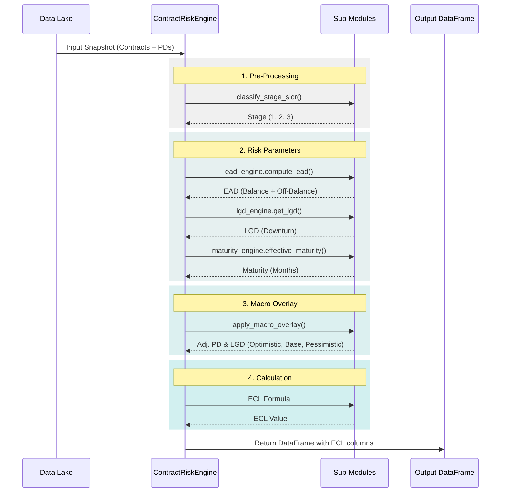

# Architecture Overview

## 1. System Context

The **Contract Risk Engine (CRE)** is designed as a standalone Python library that integrates into a larger credit risk management ecosystem.

```mermaid
graph TB
    User[Risk Analyst / Data Scientist]
    BankSystem[Core Banking / Data Lake]
    CRE[Contract Risk Engine Lib]
    Regulatory[Regulatory Reporting System]
    Provisioning[Provisioning System (Accounting)]

    User -->|Configures & Runs| CRE
    BankSystem -->|Provides Contracts & Payment Data| CRE
    CRE -->|Outputs Contract-Level ECL| Provisioning
    CRE -->|Outputs Aggregated Metrics| Regulatory
```

---

## 2. Component Design

The library is structured around the `ContractRiskEngine` orchestrator, which delegates specific risk modeling tasks to specialized engines.

### 2.1 Core Modules

| Module | Class | Responsibility |
|--------|-------|----------------|
| **Orchestrator** | `ContractRiskEngine` | Manages the data flow and calculation sequence. Initializes all sub-engines. |
| **LGD Engine** | `LGDRatingEngine` | Stores and retrieves LGD values based on product schema and collateral. |
| **EAD Engine** | `ead_engine` (func) | Estimates Credit Conversion Factors (CCF) and computes EAD. |
| **Maturity** | `maturity_engine` (func) | Determines effective maturity $M$ for discounting. |
| **Staging** | `staging` (func) | Applies SICR rules to classify contracts into Stage 1, 2, or 3. |
| **Forward-Looking** | `forward_looking` (func) | Applies macro-economic scalars to PD and LGD. |

### 2.2 Data Flow



---

## 3. Technology Stack

- **Language**: Python 3.10+
- **Data Processing**: Pandas (Vectorized operations), NumPy
- **Visualization**: Matplotlib, Plotly
- **Testing**: Pytest
- **CI/CD**: GitHub Actions (planned)

## 4. Scalability Considerations

- **Vectorization**: All core calculations use Pandas vectorization for performance on datasets up to ~10M rows.
- **Spark Integration**: The `TransitionMatrixLearner` supports PySpark DataFrames for transition matrix calculation on big data (tb-scale), while contract-level ECL is typically computed on aggregated or stratified samples if local memory is constrained.
